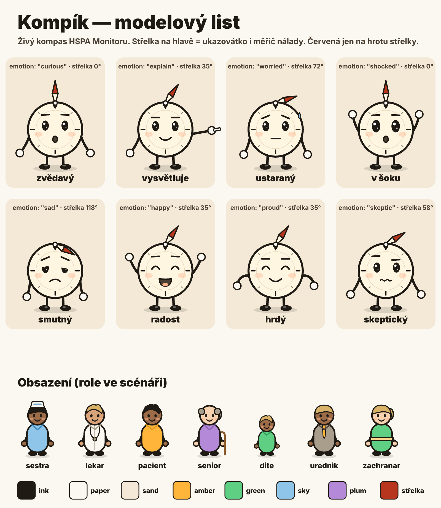

# Animované příspěvky s Kompíkem

Místo statické karty krátký animovaný skeč: **Kompík** (živý kompas, maskot HSPA
Monitoru) položí otázku, na scénu naskáčou postavičky, které číslo *ukážou* tělem,
přijde pointa s reakcí a koncová karta s odkazem. Žádné grafy, žádné fotky —
postavičky, emoce, rytmus. Jedno video = jedno číslo = jedna pointa.

| | |
|---|---|
| Formát | 9:16, 1080×1920, 30 fps, H.264 + AAC. Němé **10–20 s**, ≤ 3 MB. Mluvené **až 60 s** (ideál 30–45 s), ≤ 6 MB |
| Na šířku | `"format": "landscape"` → 16:9, 1920×1080, němé ≤ 40 s, mluvené ≤ 90 s — jen pro vložení do webu (sekce, průvodce), ne do Reels |
| Hlasy | `05_M1_Starter/social/reels/voices.json` (obsazení), nahrávky `social/reels/voice/<slug>/`, hudba a efekty `social/reels/audio/` |
| Výstup | `05_M1_Starter/assets/social/reels/<slug>.mp4` + plakát `<slug>.png` |
| Scénář | `05_M1_Starter/social/reels/scripts/<slug>.json` (verzovaný, testovaný) |
| Renderer | `05_M1_Starter/social/reels/` — SVG → resvg → ffmpeg, offline, deterministický |
| Tváře a logo | `05_M1_Starter/assets/brand/maskot/` — Kompík (`kompik-avatar.png`, `kompik-logo.png`, `kompik.png`, `kompik-list.png`), Florence (`florence-avatar.png`, `florence.png`, `florence-list.png`) |

## Dva styly

| | **Kompík vysvětluje** (výchozí) | **Florence komentuje** (`"style": "florence"`) |
|---|---|---|
| Na co | srovnání dvou čísel, laskavě a srozumitelně | paradox, mýtus, ironický komentář — hlavně zaujmout |
| Vizuál | světlá scéna, dav postaviček, bublina | tmavá scéna, lampa, velké titulky po kouscích |
| Soubor | `scripts/<slug-článku>.json` → `reels/<slug-článku>.mp4` | `scripts/florence-<…>.json` → `reels/florence-<…>.mp4` |

Střídej je: Kompík je „vysvětlující" série, Florence „komentářová". Ke stejnému
článku může vzniknout obojí.

## Mluvená videa a dialog (od 20. 11. 2026)

Oba styly smí mluvit hlasem z ElevenLabs a ve stylu Kompík může vystoupit **host**:
Florence nebo role z obsazení (sestra, lékař, pacient, senior, úředník, záchranář).
Vlajkový formát je **„Kompík a Florence"**: Kompík řekne, co si myslí divák, Florence
dodá háček, čísla ukážou postavičky. Vzor: `scripts/duo-sestry-absolventi.json`.

| Formát | Kdy | Délka |
|---|---|---|
| **Kompík a Florence** (dialog) | číslo, které na první pohled klame; mýtus proti datům | 30–50 s |
| **Kompík se ptá** (host = role) | téma má lidskou stranu, kterou článek dokládá (sestra, pacient, senior) | 30–45 s |
| **Florence komentuje** (mluvená, sólo) | paradox, jedna ostrá myšlenka | 20–35 s |
| **Kompík vysvětluje** (mluvený, sólo) | čisté srovnání dvou čísel | 20–30 s |

Všechno o hlasech, dialogu, hudbě, efektech a kreditech je v
[`references/hlasy.md`](references/hlasy.md) — **přečti ho před každým mluveným videem**.
Němé video (žvatlání, titulky) je dál platný formát a záloha, když konektor
ElevenLabs není k dispozici.

Než začneš, přečti podle potřeby:
- [`references/postavy.md`](references/postavy.md) — kdo je Kompík, jak mluví, emoce a střelka, obsazení
- [`references/florence.md`](references/florence.md) — styl „Florence komentuje": postava, nálady, gesta, beaty, dramaturgie
- [`references/scenar.md`](references/scenar.md) — formát JSON scénáře, typy beatů, všechny parametry
- [`references/dramaturgie.md`](references/dramaturgie.md) — jak z čísla udělat virální skeč (háčky, rytmus, vzory, dialog)
- [`references/hlasy.md`](references/hlasy.md) — mluvená videa: obsazení, dialog s hostem, výroba hlasu v ElevenLabs, hudba, efekty, kredity

## Postup (jedno video)

Pracovní adresář `05_M1_Starter/`.

1. **Vyber článek** s jedním silným, doloženým číslem a jasným srovnáním (ČR vs.
   OECD/EU, dřív vs. teď, kraj vs. kraj). Kandidáti: články s IG kartou v manifestu
   `scripts/generate-ig-cards.js` — `stat`, `claim` a `context` jsou hotová kostra
   příběhu. Jen viditelné články (`published !== false`, `audit-status` ∉
   {`draft`, `flagged`, `draft-flagged`}).
2. **Vypiš fakta** do `facts[]`: hodnota, jednotka, rok, zdroj a **doslovná citace
   věty z článku**, ve které číslo stojí. Test `tests/reels-engine.test.js` ověří,
   že citace v článku opravdu je — číslo, které v článku není, do videa nesmí.
3. **Napiš scénář** `social/reels/scripts/<slug>.json` podle vzoru
   `clanek-absolventi-osetrovatelstvi.json` a dramaturgie (háček → číslo → srovnání →
   pointa → karta). Repliky krátké, mluvené, česky; zvýraznění `*takhle*`.
4. **Zkontroluj** `npm run reels:check` (délka, rezerva repliky, ≤ 3 řádky bubliny,
   poctivost počtu postaviček ±10 %, zdroj, outro).
5. **Náhled** `npm run reels:render -- <slug> --sheet` → `social/reels/out/<slug>-arch.png`
   (gitignored). **Podívej se na něj** (Read) — čitelnost, překryvy, emoce sedí k textu.
   Detail jednoho okamžiku: `--frame 9.8`.
6. **Render** `npm run reels:render -- <slug>` (~80 s) → MP4 + plakát do
   `assets/social/reels/`. Zkontroluj `ffprobe` (1080×1920, 30 fps, délka) a
   velikost ≤ 3 MB.
7. **Commit** scénář + MP4 + plakát do PR (`content(reels): <slug>`). Do fronty Bufferu
   jde video až když je **živé na produkci** (HTTP 200 na
   `https://skorezdravotnictvi.cz/assets/social/reels/<slug>.mp4`), stejně jako karty.

## Video na šířku (web)

Pro vložení do stránky webu (`<video>` v sekci, např. `poplatky.html`) přidej do
scénáře `"format": "landscape"`. Scéna se přeskládá na 16:9: Kompík vlevo,
tabule / skupiny vpravo; Florence vpravo s lampou, titulky a kroky vlevo. Strop
délky je 35 s (portrait dál 20 s). Na šířku dávají smysl dva nové beaty:

- **`board`** (Kompík) — tabule „smí / nesmí": 2–6 řádků, každý s razítkem
  `verdict: ne|zalezi|ano` (NESMÍ / JEN ZA PODMÍNEK / SMÍ, nebo vlastní `stamp`,
  např. „90 Kč") a povinným `basis` (kazuistika, paragraf). Hodí se na výklad
  pravidel bez čísla k porovnání.
- **`step`** (Florence) — návod krok za krokem: `n`, `title` (≤ 40 znaků, čísla jen
  z faktů), `basis`; kroky se skládají do seznamu, hotové dostanou fajfku. Nejvýš 6.

S hlasem: postup je v `references/hlasy.md` (repliky po beatech, `--fit-voice`
nastaví délky beatů podle naměřené řeči). Bublina a titulky se na řeč srovnají samy,
pusa jde podle hlasitosti, podkres se pod hlasem ztiší. U tabule sesynchronizuj řádky
s výčtem (`items[].at`, `stamp_at`). Strop mluveného videa na šířku je 90 s.

Fakta se dokládají stejně, `article` může být i sekční stránka (`poplatky.html`).
Ověř obraz archem (`--sheet` je na šířku 3×4) a vlož video do stránky s plakátem,
`preload="none"` a textovým přepisem titulků pod videem.

## Fakta a poctivost (červené linie — GOVERNANCE § 2 a § 6)

- **Žádné číslo z paměti.** Každé číslo ve videu (bublina, cedule, počet postaviček,
  pointa) musí stát v článku; `facts[].quote` je doslovná věta z článku.
  Validátor odmítne každé číslo napsané v replice, pointě, popisku nebo výzvě, které
  není hodnotou, rokem ani číslem z citace některého faktu. Čísla vyslovená slovy
  („šestnáct“) strojově hlídat nejde — ta kontroluješ ty proti `facts[]`.
- **Obraz nesmí klamat.** Počet postaviček × `per` se od hodnoty liší nejvýš o 10 %
  (validátor). Když se hodnota nedá poctivě vyjádřit postavičkami (procenta, miliardy),
  použij `per` (1 postavička = 10 %, = 1 mld.) a napiš to do `footnote`.
- **Pointa má základ.** `punch.basis` říká, z čeho plyne („16,1 / 34,8 = 0,46").
  Žádné nadsázky nad rámec článku („katastrofa", „kolaps", „nejhorší na světě"),
  pokud je článek sám nedokládá.
- **Mluvené číslo smí být zaokrouhlené** („šestnáct"), **psané musí být přesné**
  (cedule pod skupinou „16,1"), definice patří do `footnote` (co postavička znamená,
  rok, populace).
- **Zdroj a AI na koncové kartě** — renderer vždy přidá `source_line` a
  „Animace a text: AI · redakce HSPA Monitor". Neodstraňovat.
- **Žádné skutečné osoby.** Postavičky jsou role (sestra, lékař, pacient…), nikdy
  karikatura politika, ministra, ředitele nebo konkrétního člověka; žádná loga
  pojišťoven, nemocnic, stran.
- **Žádné zdravotní rady jednotlivci.** Kompík vysvětluje systém a data, neříká
  „běžte na…", „berte…". Prevence jen jako systémový fakt („půlka lidí prohlídku vynechá").
- **Hlas je syntetický a přiznaný.** Postavy smí mluvit hlasem z ElevenLabs
  (vydavatel: 13. 10. 2026 web na šířku, 20. 11. 2026 i sociální sítě). Jen hlasy
  z knihovny nebo navržené z textového popisu, zapsané v `social/reels/voices.json`;
  **nikdy klon ani imitace hlasu skutečné osoby**, žádný dětský hlas. Koncová karta
  nese `voice_credit` (povinné), popisek příspěvku říká „Animace, text a hlasy: AI".
  Postavy nepředstírají člověka: Florence je AI, host je role, ne osoba.
- **Mluvené slovo je stejně doložené jako psané.** `spoken` (text poslaný do hlasu)
  hlídá validátor na čísla stejně jako `line`. Čísla vyslovená slovy kontroluješ ty
  proti `facts[]`; repliku s číslem ověř přepisem (hlasy.md, krok 8).
- **Video musí dávat smysl i bez zvuku.** Hlas titulky nenahrazuje — bublina nebo
  titulek nese pointu každé repliky.
- **Florence je vždy označená jako AI** (odznak na klopě, štítek nahoře, koncová karta).
  Je krásná a sebevědomá — šarm, mrknutí, ironie — ale ne lascivní (žádný výstřih
  ani vyzývavé pózy; sítě to navíc tlumí v dosahu).

## Brand

- Červená (`#B8361E`) patří **jen hrotu střelky** — Kompíkovy a v miniznačce kompasu.
  Postavičky, cedule a pointy barví jantar / zeleň / nebeská / švestka (`lib/palette.js`).
  Hlídá test.
- Font Inter (statické řezy v `social/reels/fonts/`), inkoust + papír + písek.
- Logo a tvář série: `assets/brand/maskot/`. Generuje `npm run brand:maskot` ze stejného
  kódu, ze kterého se kreslí videa — při změně postavy přegeneruj.

## Kontrolní seznam před commitem

- [ ] `npm run reels:check` ✅ a `node --test tests/reels-engine.test.js` ✅
- [ ] Prohlédnutý kontaktní arch: bublina ≤ 3 řádky, nic důležitého pod y 1560 ani nad y 230
- [ ] Háček do 1. sekundy, první číslo do 4. sekundy (mluvené do 8. s), celé ≤ 20 s (mluvené ≤ 60 s)
- [ ] Každé číslo má `facts[]` s citací; počet postaviček sedí; `footnote` vysvětluje jednotku
- [ ] Emoce Kompíka sedí k obsahu (dobrá zpráva ≠ smutek); tón pointy `good|warn|bad` odpovídá signálu článku
- [ ] MP4 1080×1920, 30 fps, ≤ 3 MB (mluvené ≤ 6 MB); plakát vygenerovaný
- [ ] Mluvené: hlasy z `voices.json`, `spoken` u každé repliky, `voice_credit`, `timing.json` commitnutý, repliky s čísly ověřené přepisem, podkres bez zpěvu
- [ ] Do PR jen scénář + MP4 + plakát + `voice/<slug>/` (+ nové soubory v `audio/`, + změny rendereru, pokud byly); **ne** `social/reels/out/`

## Hranice skillu

- Skill **vyrábí** video a scénář. **Nepublikuje.** Denní rutina (`PROMPT_ROUTINE.md`)
  vyrobí blokem V až dvě videa za běh (mluvený dialog + sólo) a blok B plní
  frontu Bufferu **výhradně video příspěvky** (reel na IG a FB, video na X) — až po
  merge a nasazení videa. Kadenci mění jen vydavatel.
- Videa jsou v gitu: němé ≤ 3 MB, mluvené ≤ 6 MB. Dvě videa denně jsou ~3 GB ročně —
  to git dlouhodobě neunese; přesun MP4 mimo repo (Vercel Blob / R2) je otevřené
  rozhodnutí vydavatele (`docs/decisions-log.md`, 20. 11. 2026).
- `thumbnailOffset` pro Buffer = `node social/reels/render.js <slug> --poster-time` (ms plakátu).
- Změna postavy, palety nebo pravidel = změna tohoto skillu + `references/` + testu.
