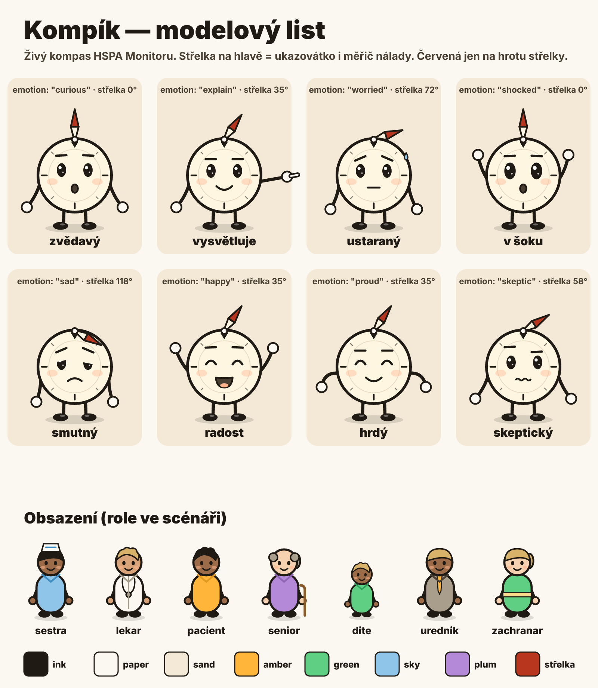

# Animované příspěvky s Kompíkem

Místo statické karty krátký animovaný skeč: **Kompík** (živý kompas, maskot HSPA
Monitoru) položí otázku, na scénu naskáčou postavičky, které číslo *ukážou* tělem,
přijde pointa s reakcí a koncová karta s odkazem. Žádné grafy, žádné fotky —
postavičky, emoce, rytmus. Jedno video = jedno číslo = jedna pointa.

| | |
|---|---|
| Formát | 9:16, 1080×1920, 30 fps, H.264 + AAC, **10–20 s** (ideál 13–16 s), ≤ 3 MB |
| Výstup | `05_M1_Starter/assets/social/reels/<slug>.mp4` + plakát `<slug>.png` |
| Scénář | `05_M1_Starter/social/reels/scripts/<slug>.json` (verzovaný, testovaný) |
| Renderer | `05_M1_Starter/social/reels/` — SVG → resvg → ffmpeg, offline, deterministický |
| Tvář a logo | `05_M1_Starter/assets/brand/maskot/` (`kompik-avatar.png`, `kompik-logo.png`, `kompik.png`, `kompik-list.png`) |

Než začneš, přečti podle potřeby:
- [`references/postavy.md`](references/postavy.md) — kdo je Kompík, jak mluví, emoce a střelka, obsazení
- [`references/scenar.md`](references/scenar.md) — formát JSON scénáře, typy beatů, všechny parametry
- [`references/dramaturgie.md`](references/dramaturgie.md) — jak z čísla udělat virální skeč (háčky, rytmus, vzory)

## Postup (jedno video)

Pracovní adresář `05_M1_Starter/`.

1. **Vyber článek** s jedním silným, doloženým číslem a jasným srovnáním (ČR vs.
   OECD/EU, dřív vs. teď, kraj vs. kraj). Kandidáti: články s IG kartou v manifestu
   `scripts/generate-ig-cards.js` — `stat`, `claim` a `context` jsou hotová kostra
   příběhu. Jen viditelné články (`published !== false`, `audit-status` ∉
   {`draft`, `flagged`, `draft-flagged`}).
2. **Vypiš fakta** do `facts[]`: hodnota, jednotka, rok, zdroj a **doslovná citace
   věty z článku**, ve které číslo stojí. Test `tests/reels-engine.test.js` ověří,
   že citace v článku opravdu je — číslo, které v článku není, do videa nesmí.
3. **Napiš scénář** `social/reels/scripts/<slug>.json` podle vzoru
   `clanek-absolventi-osetrovatelstvi.json` a dramaturgie (háček → číslo → srovnání →
   pointa → karta). Repliky krátké, mluvené, česky; zvýraznění `*takhle*`.
4. **Zkontroluj** `npm run reels:check` (délka, rezerva repliky, ≤ 3 řádky bubliny,
   poctivost počtu postaviček ±10 %, zdroj, outro).
5. **Náhled** `npm run reels:render -- <slug> --sheet` → `social/reels/out/<slug>-arch.png`
   (gitignored). **Podívej se na něj** (Read) — čitelnost, překryvy, emoce sedí k textu.
   Detail jednoho okamžiku: `--frame 9.8`.
6. **Render** `npm run reels:render -- <slug>` (~80 s) → MP4 + plakát do
   `assets/social/reels/`. Zkontroluj `ffprobe` (1080×1920, 30 fps, délka) a
   velikost ≤ 3 MB.
7. **Commit** scénář + MP4 + plakát do PR (`content(reels): <slug>`). Do fronty Bufferu
   jde video až když je **živé na produkci** (HTTP 200 na
   `https://skorezdravotnictvi.cz/assets/social/reels/<slug>.mp4`), stejně jako karty.

## Fakta a poctivost (červené linie — GOVERNANCE § 2 a § 6)

- **Žádné číslo z paměti.** Každé číslo ve videu (bublina, cedule, počet postaviček,
  pointa) musí stát v článku; `facts[].quote` je doslovná věta z článku.
- **Obraz nesmí klamat.** Počet postaviček × `per` se od hodnoty liší nejvýš o 10 %
  (validátor). Když se hodnota nedá poctivě vyjádřit postavičkami (procenta, miliardy),
  použij `per` (1 postavička = 10 %, = 1 mld.) a napiš to do `footnote`.
- **Pointa má základ.** `punch.basis` říká, z čeho plyne („16,1 / 34,8 = 0,46").
  Žádné nadsázky nad rámec článku („katastrofa", „kolaps", „nejhorší na světě"),
  pokud je článek sám nedokládá.
- **Mluvené číslo smí být zaokrouhlené** („šestnáct"), **psané musí být přesné**
  (cedule pod skupinou „16,1"), definice patří do `footnote` (co postavička znamená,
  rok, populace).
- **Zdroj a AI na koncové kartě** — renderer vždy přidá `source_line` a
  „Animace a text: AI · redakce HSPA Monitor". Neodstraňovat.
- **Žádné skutečné osoby.** Postavičky jsou role (sestra, lékař, pacient…), nikdy
  karikatura politika, ministra, ředitele nebo konkrétního člověka; žádná loga
  pojišťoven, nemocnic, stran.
- **Žádné zdravotní rady jednotlivci.** Kompík vysvětluje systém a data, neříká
  „běžte na…", „berte…". Prevence jen jako systémový fakt („půlka lidí prohlídku vynechá").
- **Kompík nemluví lidským hlasem** a nepředstírá člověka — žvatlá tóny, text nese
  bublina. Žádné klonování hlasů skutečných lidí.

## Brand

- Červená (`#B8361E`) patří **jen hrotu střelky** — Kompíkovy a v miniznačce kompasu.
  Postavičky, cedule a pointy barví jantar / zeleň / nebeská / švestka (`lib/palette.js`).
  Hlídá test.
- Font Inter (statické řezy v `social/reels/fonts/`), inkoust + papír + písek.
- Logo a tvář série: `assets/brand/maskot/`. Generuje `npm run brand:maskot` ze stejného
  kódu, ze kterého se kreslí videa — při změně postavy přegeneruj.

## Kontrolní seznam před commitem

- [ ] `npm run reels:check` ✅ a `node --test tests/reels-engine.test.js` ✅
- [ ] Prohlédnutý kontaktní arch: bublina ≤ 3 řádky, nic důležitého pod y 1560 ani nad y 230
- [ ] Háček do 1. sekundy, první číslo do 4. sekundy, celé ≤ 20 s
- [ ] Každé číslo má `facts[]` s citací; počet postaviček sedí; `footnote` vysvětluje jednotku
- [ ] Emoce Kompíka sedí k obsahu (dobrá zpráva ≠ smutek); tón pointy `good|warn|bad` odpovídá signálu článku
- [ ] MP4 1080×1920, 30 fps, ≤ 3 MB; plakát vygenerovaný
- [ ] Do PR jen scénář + MP4 + plakát (+ změny rendereru, pokud byly); **ne** `social/reels/out/`

## Hranice skillu

- Skill **vyrábí** video a scénář. **Nepublikuje** — zařazení do Bufferu řídí
  `PROMPT_ROUTINE.md` blok B (vertikální slot: „Reel jen když existuje video
  `assets/social/reels/<slug>.mp4`"). Kadenci a zapojení do rutiny mění jen vydavatel.
- Videa jsou v gitu: drž ≤ 3 MB a rozumnou kadenci (doporučeno 2–3 týdně), ať repo
  nebobtná.
- Změna postavy, palety nebo pravidel = změna tohoto skillu + `references/` + testu.
